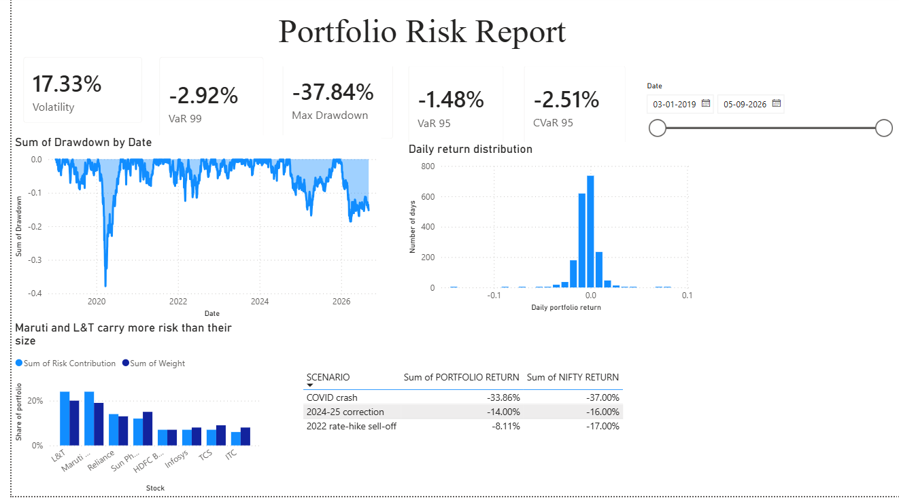

# Hypothetical Portfolio and Risk Report

## The Setup  
Picture investing Rs 4.78 lakh across eight of India’s biggest companies: Reliance, TCS, HDFC Bank, Infosys, ITC, Maruti Suzuki, Sun Pharma, and L&T. Since your money is distributed across seven sectors, the portfolio looks reasonably diversified. Still, the real question is how much it can protect you if the market suddenly turns lower.

To answer this, I used historical daily prices from January 2019 to October 2026. I analysed portfolio risk in Excel and then used Power BI to put together an interactive dashboard.

## The Story Behind the Numbers  
Under normal conditions, the portfolio’s annualised volatility was **17.3%**. The 95% Value at Risk (VaR) worked out to a daily loss limit of **1.48%**, which is roughly Rs 7,000. But once market conditions became harsher, the numbers changed. At the 99% level, VaR rose to **2.91%**, and the average loss across the worst 5% of days was **2.49%**.

To see whether these VaR estimates were realistic, I compared them with historical returns. At the 95% confidence level, the VaR breach rate came out to **5.05%**, which matches closely with the expected 5%.

Then came the real stress test: three major market corrections.  
The portfolio held up relatively well during the 2022 sell-off. However, the COVID crash made it clear that diversification cannot fully remove risk that affects the market as a whole. 

## The Biggest Surprise  
The risk contribution analysis revealed something I didn’t expect:

- **L&T:** 20% of the portfolio, but 24% of the risk.  
- **Maruti Suzuki:** 19% of the portfolio, but 24% of the risk.  
- **Sun Pharma, TCS, and ITC:** These contributed less risk than their investment share would suggest.  

In simple terms, L&T and Maruti Suzuki together accounted for about **39%** of the portfolio, yet they contributed roughly **48%** of its total risk.

So the key point is this: even if a portfolio looks diversified based on the number of stocks and sectors it contains, it may still be concentrated in terms of risk.

## Conclusion  
Overall, the analysis indicates that spreading investments across multiple sectors can help reduce losses during some market corrections, but it cannot fully eliminate the effect of a broader market crash. The COVID-19 period also made it clear how quickly losses can build up. And the risk contribution results showed that L&T and Maruti Suzuki together made up nearly **48%** of the portfolio’s total risk, despite representing only **39%** of its value.

The main takeaway is that diversification should be evaluated not only by how evenly the capital is distributed, but also by how much risk each holding contributes to the portfolio.

## Assumptions and Limitations
- Today's holdings are applied to the whole history ("what if I had held this portfolio throughout?").
- No transaction costs, taxes or rebalancing.
- Prices are adjusted for splits and dividends; 252 trading days per year.
- Crash windows use approximate Nifty peak and trough dates.
- History may not repeat. VaR is a threshold, not a worst case. A normal distribution understates fat tails, and correlations rise in crashes.

## Files
- `Risk_Report.xlsx`: Excel workbook (returns, weights, risk metrics, stress tests)
- `Portfolio_Risk_Dashboard.pbix`: Power BI dashboard (needs Power BI Desktop)
- `prices_2019.csv`: price data
  
